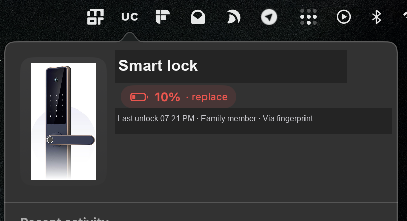

# UC Lock



A small macOS menu bar app for the Urban Company Native Lock Pro. It shows the lock state,
battery, recent activity and visitor photos without opening the phone app.

## Features

- Live battery level, with a warning colour at low charge.
- Last unlock: who unlocked it, when, and by which method.
- Recent activity feed, including door bell rings with visitor photos.
- Full-size photo viewer for door bell events.
- Optional local portraits for family unlocks. Add your own photos and names in
  `~/Library/Application Support/UC Lock/family.json`; names are never stored in this repo.
- Read-only. The app never unlocks the door and never approves gate requests.

## How it works

The phone app renders the lock screens from a server-driven UI. Both screens come from one
endpoint:

    POST https://www.urbanclap.com/api/v2/supply/appliances/getScreenDetails

- `screenName: device_details` returns artwork, battery tag and the low-battery nudge.
- `screenName: unlock_logs_page` returns the activity feed with signed photo URLs.

The app replays the same request headers as the phone app and polls every 25 seconds. It parses
the JSON locally. No Urban Company push channel is used.

## Who can use it

This is not a sign-in app. It needs a bearer token plus the device, appliance and user IDs from
your own Urban Company session. The city key must match your city. Expect a manual setup.

## Setup

1. Copy the bearer token from your own Urban Company app session.
2. Create `~/Library/Application Support/UC Lock/config.json` with `0600` permissions:

```json
{
  "token": "YOUR_SESSION_TOKEN",
  "deviceId": "YOUR_DEVICE_ID",
  "applianceId": "YOUR_APPLIANCE_ID",
  "userId": "YOUR_UC_USER_ID",
  "cityKey": "city_bangalore_v2",
  "countryKey": "IND",
  "clientKey": "",
  "versionName": "7.6.87",
  "versionCode": "726",
  "bundleVersion": "936",
  "sessionId": "RANDOM_UUID",
  "advertisingId": "RANDOM_UUID"
}
```

No credentials are compiled into the binary. They stay in Application Support.

## Build

    ./build.sh
    cp -R "Build/UC Lock.app" ~/Applications/
    open "$HOME/Applications/UC Lock.app"

A LaunchAgent starts it at login:

    ~/Library/LaunchAgents/com.secureu.uclock.plist

## Optional family portraits

Create `family.json` beside `config.json`:

```json
{
  "members": [
    {"name": "Alex", "aliases": ["alex"], "role": "Dad", "image": "dad.jpg"}
  ]
}
```

Put the image files in the same folder. When an unlock event has no photo and the title matches
an alias, the app shows that portrait. Without this file the app shows a neutral lock icon.

## Privacy

The repository contains no tokens, device IDs, user IDs, phone numbers or personal photos.
Portraits, credentials and diagnostics stay in `~/Library/Application Support/UC Lock/`.

## Limits

- The session token is fixed in the config. A logout or revocation needs a fresh token.
- Photo URLs are signed and expire in about five minutes. The app refreshes them on each poll.
- No push notifications. The menu bar icon and the in-app banner are the alerting mechanism.

## License

MIT. See `LICENSE`.
